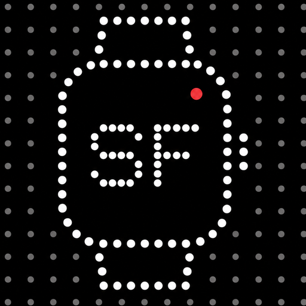
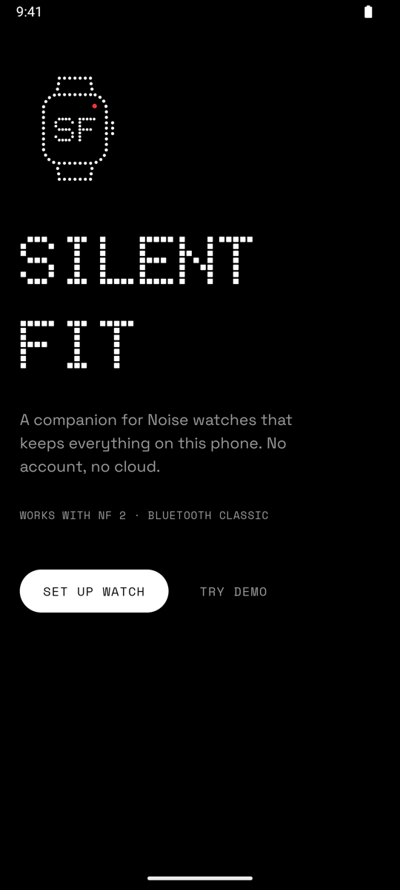
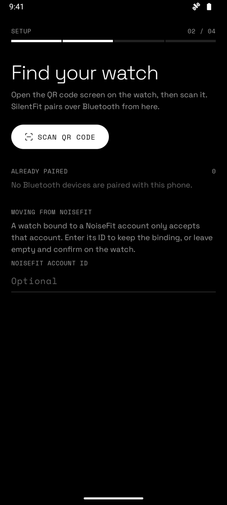
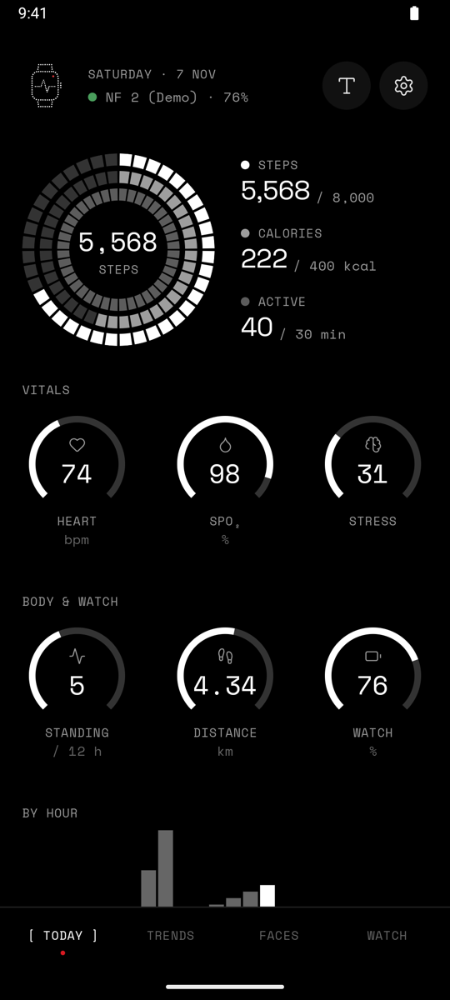
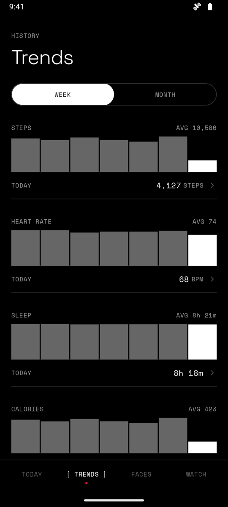
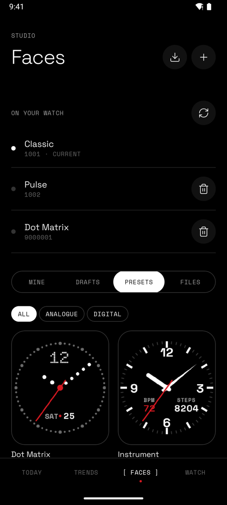
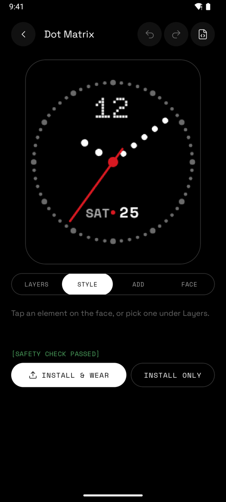
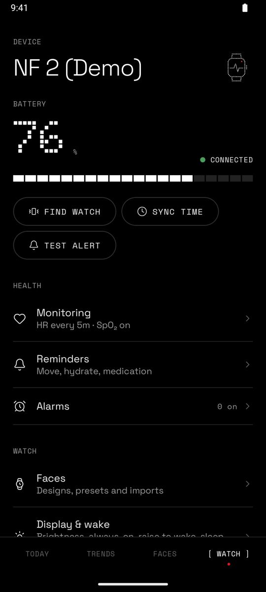
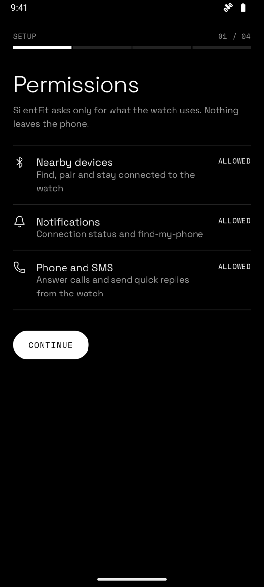

<p align="center">
  <picture>
    <source media="(prefers-color-scheme: dark)" srcset="docs/assets/img/logo-dark.png">
    <source media="(prefers-color-scheme: light)" srcset="docs/assets/img/logo-light.png">
    
  </picture>
</p>

# SilentFit

SilentFit is a companion app for Noise smartwatches that works without NoiseFit, an
account or the internet. It talks to the watch over Bluetooth using the watch's own
protocol (Berry). Health data is stored on the phone and nowhere else. The app has no
network permission.

The Android app is native Kotlin and Jetpack Compose. The Apple apps (macOS, iOS,
iPadOS) are SwiftUI, built from the Swift package in this repository.

<table>
  <tr>
    <td></td>
    <td></td>
    <td></td>
    <td></td>
  </tr>
  <tr>
    <td></td>
    <td></td>
    <td></td>
    <td></td>
  </tr>
</table>

Screenshots are from demo mode, which uses simulated data.

## Download

Get the APK from [Releases](https://github.com/Ebullioscopic/SilentFit/releases/latest).
It needs Android 10 or later. The release is signed with the project's own key, so it
cannot update a debug build you compiled yourself. Uninstall that one first.

## Compatibility

Tested on a Noise NF 2 (model 59004, firmware 1.0.39) with a phone on Android 16. Other
Noise watches that use the Berry protocol may sync and receive notifications, but the
command allowlist and the face rules were worked out on the NF 2 only. See
[Adding another Noise model](markdowns/REVERSE_ENGINEERING.md#8-adding-another-noise-model).

| | Android | macOS | iPhone / iPad |
|---|---|---|---|
| NF 2 (Bluetooth Classic) | Yes | Yes | No. iOS does not allow Bluetooth Classic serial |
| Berry BLE watches | No | No | Experimental |
| Notifications, calls, music | Yes | No | No |

The reasoning is in [Platform map](markdowns/PLATFORM_MAP.md).

## What it does (Android)

**Setup.** Scan the QR code on the watch. SilentFit reads its Bluetooth address, pairs
with it and walks you through the confirmation on the watch. A watch already paired
with the phone can be picked from a list instead.

**Health.** Steps, distance, calories, active minutes, standing hours, heart rate
through the day, sleep stages, SpO₂ and stress. Data is synced from the watch in the
background and kept as daily history. If the watch restarts during the day, its
counters start again from zero; SilentFit keeps what was already synced and adds to it.

**Workouts.** Workouts recorded on the watch are downloaded after each sync. This is new
and has been checked against the file format, not yet against many real workouts.

**Notifications and calls.** App notifications are forwarded with the app's own icon on
the watch for about 40 common apps; others show as a generic message with the app name.
Calls can be answered or declined from the watch, and SMS quick replies are sent from
the phone.

**Music.** The watch's music screen shows the current track and controls whatever is
playing on the phone.

**Watch settings.** Heart-rate, SpO₂ and stress monitoring, do-not-disturb, raise to
wake, reminders and alarms can be changed. Each change is read back from the watch to
confirm it. Settings that cannot be confirmed this way are shown read-only. Alarms can
also be copied to the phone's clock app.

**Faces.** A face editor with presets, a JSON format for hand-written faces, and import
of `.sfface` files and compiled faces. A [web version](docs/README.md) of the editor
runs in the browser and exports files the app can install.

**Widgets.** A Today widget (steps, goal, heart rate, sleep, calories) and a Watch
widget (battery and connection).

## Using it alongside NoiseFit

The watch accepts one app on its data connection. If NoiseFit is installed it will keep
trying to reconnect. When that happens SilentFit stops retrying and shows *Another app
is using your watch*. Either uninstall NoiseFit or set its battery usage to
*Restricted*. Your NoiseFit account ID can be entered during setup to keep the watch's
existing pairing; see the [User guide](markdowns/USER_GUIDE.md).

## Watch safety

The NF 2 firmware does not check what it receives. A malformed face once left a test
watch restarting in a loop until it was factory reset. For that reason SilentFit:

* only sends commands that were captured from NoiseFit on this watch, or read-only
  requests. Writes to watch settings are limited to ones the watch reports back, and
  each is checked after it is sent
* only installs faces whose every record matches the layout of an official face
* asks before installing a face, and switches back to the previous face if the watch
  drops off Bluetooth within three minutes of the new one being applied

## Documentation

| Document | Contents |
|----------|----------|
| [User guide](markdowns/USER_GUIDE.md) | Setup, moving from NoiseFit, everyday use, troubleshooting |
| [Designing watch faces](markdowns/WATCHFACE_DESIGN.md) | The face editor, presets and the `.sfface.json` format |
| [Watch-face format](markdowns/WATCHFACE_FORMAT.md) | WF container, PAR image codec, data ids, install flow, safety rules |
| [Designer handoff](markdowns/HANDOFF_WATCHFACE_DESIGNER.md) | Model, rendering, compiler and safety rules behind the web editor |
| [Platform map](markdowns/PLATFORM_MAP.md) | Architecture, per-platform features, battery use |
| [Berry protocol](markdowns/PROTOCOL.md) | Transport, framing, handshake, commands, safety policy, sync |
| [NoiseFit analysis](markdowns/NOISEFIT_ANALYSIS.md) | How the NoiseFit app is put together |
| [Reverse engineering](markdowns/REVERSE_ENGINEERING.md) | Method and tools |

## Building

Requires JDK 17 or later, the Android SDK and Gradle 9 (`brew install gradle`). Xcode
for the Apple apps.

```bash
cd Android
gradle :core:test :app:assembleDebug
adb install -r app/build/outputs/apk/debug/app-debug.apk

swift test                    # Swift package tests
open Project.xcworkspace      # Apple apps, scheme "SilentFit App"
```

`gradle :app:assembleRelease` signs with `Android/app/keystore.properties` when that
file exists (it is not in the repository) and with the debug key otherwise.

Set `SILENTFIT_FACE_SAMPLE=/path/to/official-face.bin` to also run the byte-exact codec
test against an official face. Official faces are not included.

## Project layout

```
Android/core/              Pure Kotlin/JVM library, unit-tested
  protocol/                Framing, protobuf codec, commands, command policy, responses
  fitness/                 Health and workout record decoders
  watchface/               PAR codec, WF container, FaceSpec, compiler, FaceSafety
Android/app/               Jetpack Compose app
  watch/                   SPP link, bonding, WatchSession (handshake, sync, uploads, face trial), service
  facestudio/              Canvas rasterizer, presets
  ui/                      Setup, Today, Trends, Faces (studio + code), Watch, Settings
  widget/                  Glance widgets
Sources/                   Swift package and SwiftUI app (Apple platforms)
Tools/                     Icon generation and helper scripts
docs/                      Website and browser face editor, screenshots, logos
markdowns/                 Documentation
logos/                     Source artwork for the app's state logos
```

## Support

SilentFit is free, with no ads or tracking. If it is useful to you, you can support its
development.

<a href="https://buymeacoffee.com/kryoscopic">
  <picture>
    <source media="(prefers-color-scheme: dark)" srcset="docs/assets/img/bmc-button-white.png">
    <source media="(prefers-color-scheme: light)" srcset="docs/assets/img/bmc-button-black.png">
    
  </picture>
</a>


Built by [Hariharan Mudaliar](https://tinyurl.com/hariharanmudaliar).

## Licence

SilentFit is licensed under the [GNU Affero General Public License v3.0](LICENSE) or
later. Third-party fonts, icons and libraries keep their own licences; see
[COPYRIGHT](COPYRIGHT).

## Disclaimer

Noise, NoiseFit and related names, logos and software are the property of their
respective owners. SilentFit is an independent project for interoperability with
hardware the author owns. It is not affiliated with or endorsed by Noise or Nothing, and
it contains no code, firmware or assets from NoiseFit or Noise devices. Health readings
are for general wellness, not medical use. The full notice is in [COPYRIGHT](COPYRIGHT).
