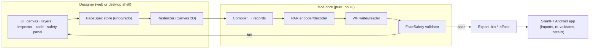

# Handoff: Web / Desktop Watch-Face Designer for the Noise NF 2

This document is everything needed to build a browser or desktop watch-face designer
that produces faces for the Noise NF 2 (Bluetrum, firmware 1.0.39) **that are guaranteed
not to harm the watch**. It describes the data model, the exact rendering rules, the
compiler, the binary formats, the safety rules, the editor UX and the style guide.

The Android app in this repository is the reference implementation. Every rule here is
implemented and tested there; file references point at it.

> **Read §8 (Safety) before writing any code.** The NF 2 firmware does not validate faces.
> A face with an unproven record id boot-looped a test watch until a factory reset. The
> designer must never emit anything outside the allowlist in §8.

---

## Contents

1. [Scope and architecture](#1-scope-and-architecture)
2. [The device](#2-the-device)
3. [Data model: `FaceSpec`](#3-data-model-facespec)
4. [Live data bindings](#4-live-data-bindings)
5. [Rendering specification](#5-rendering-specification)
6. [Compiler: spec → records](#6-compiler-spec--records)
7. [Binary formats: WF container and PAR images](#7-binary-formats)
8. [Safety rules (must port 1:1)](#8-safety-rules)
9. [Installing on the watch](#9-installing-on-the-watch)
10. [Designer UX specification](#10-designer-ux-specification)
11. [Style guide](#11-style-guide)
12. [Preset catalogue](#12-preset-catalogue)
13. [Testing and acceptance](#13-testing-and-acceptance)
14. [Known unknowns and how to extend](#14-known-unknowns-and-how-to-extend)
15. [Source map](#15-source-map)

---

## 1. Scope and architecture

### What to build

A visual editor that creates, edits, previews, validates and exports NF 2 watch faces:

- drag-and-drop canvas at the watch's true resolution, with zoom
- a layer list, an inspector, a JSON code view and a live safety panel
- presets, import (`.sfface`, `.sfface.json`, WF `.bin`) and export (same three)
- optional (desktop only, phase 2): direct install over Bluetooth Classic

### Recommended architecture



- **Core**: port `Android/core/src/main/kotlin/fit/silent/core/watchface/*` to
  TypeScript (or Rust → WASM). It is ~900 lines with no platform dependencies. Kotlin
  Multiplatform (Kotlin/JS or Wasm) can reuse the code directly; that is the lowest-risk
  route.
- **Rasterizer**: the only platform-specific part. Use Canvas 2D (`OffscreenCanvas` in a
  worker for compile). It must follow §5 exactly, so sizes and positions match.
- **Shell**: a plain web app (Vite + TypeScript + React/Svelte/Solid) works everywhere.
  For a desktop app wrap the same code in Tauri (small, native Bluetooth via Rust) or
  Electron.

### Output contract

| Output | Use | Notes |
|--------|-----|-------|
| `.sfface.json` | Source of truth, human-editable | §3 schema |
| `.sfface` | Zip: `face.json` + `assets/<name>.png` | Assets are inlined as base64 on import |
| `.bin` (WF) | Ready-to-install watch file | Must pass §8; the app re-validates on import |

The **Android app stays the installer** for the browser version: Web Bluetooth cannot
open Bluetooth Classic RFCOMM/SPP, which is the only transport the NF 2 offers. The user
exports a file and opens it in SilentFit (Faces › Import). A desktop app may install
directly (§9) but must use the same validator and trial watchdog.

---

## 2. The device

| Property | Value |
|----------|-------|
| Screen | **240 × 280 px**, rounded corners (radius reported by the watch: **28 px**) |
| Panel | Low-resolution LCD; images are stored as RGB565 (5-6-5 bit colour) |
| Pixel density | Low — fine detail disappears; see legibility rules (§11.3) |
| Analogue pivot | Screen centre **(120, 140)** — the only pivot proven |
| Downloaded faces | **One** at a time; three built-in faces cannot be removed |
| Face file size | Official faces 54–109 KB; keep under 400 KB |

Colour precision: RGB565 has 32 red/blue and 64 green levels. Subtle gradients band;
choose flat colours and test dark greys (`#1C1C1C` and below may crush to black).

---

## 3. Data model: `FaceSpec`

Source: `core/.../watchface/FaceSpec.kt`. JSON, UTF-8. Unknown keys are ignored (forward
compatible); omitted keys take their defaults. Coordinates are integer screen pixels,
origin top-left.

### 3.1 Top level

| Key | Type | Default | Notes |
|-----|------|---------|-------|
| `format` | string | `"silentfit.face"` | **Required**, exact |
| `version` | int | `1` | |
| `name` | string | `"Untitled"` | Shown in lists |
| `author` | string | `""` | |
| `width`, `height` | int | `240`, `280` | Only 240 × 280 passes §8 |
| `background` | object | black | §3.2 |
| `elements` | array | `[]` | Drawn in order (later = on top) |
| `assets` | object | `{}` | `name → base64 PNG/JPEG` |

### 3.2 `background`

| Key | Type | Default | Notes |
|-----|------|---------|-------|
| `color` | colour | `#000000` | |
| `image` | string? | — | Asset name, drawn *cover*-fit over `color` |
| `pattern` | enum | `none` | `none`, `dots`, `grid`, `lines` |
| `patternColor` | colour | `#222222` | |
| `patternSpacing` | int | `12` | Clamped 4–64 |

### 3.3 Element

| Key | Type | Default | Applies to |
|-----|------|---------|-----------|
| `id` | string | — | all; unique |
| `type` | enum | — | `number`, `sprite`, `hand`, `text`, `shape`, `image` |
| `x`, `y`, `w`, `h` | int | `0` | all (meaning per type, §5) |
| `bind` | string? | — | `number`, `sprite`, `hand` (§4) |
| `text` | string? | — | `text` |
| `font` | enum | `space-mono` | `doto`, `space-mono`, `space-grotesk` |
| `size` | float | `16` | font px; shapes: per shape; hands: centre-cap diameter ×4 |
| `weight` | int | `400` | 300, 400, 500, 700 (Space Mono: 400/700; Doto: 700) |
| `color` | colour | `#FFFFFF` | |
| `align` | enum | `left` | `left`, `center`, `right` (§5.6, §6.3) |
| `tracking` | float | `0` | letter spacing in em |
| `uppercase` | bool | `false` | |
| `glyph` | enum | `font` | `font`, `dot-matrix`, `segment` (text, number, sprite) |
| `ghost` | colour? | — | unlit dots/segments |
| `rotation` | int | `0` | 0/90/180/270; **text and sprite only** |
| `shape` | enum? | — | §5.4 |
| `stroke` | float | `2` | shapes/hands width |
| `fill` | bool | `true` | `rect`, `circle` |
| `startAngle`, `sweep` | float | `0`, `360` | arcs/ticks/dot-ring; 0° = 12 o'clock, clockwise |
| `count` | int | `12` | ticks/dots/segments |
| `src` | string? | — | `image` asset name |
| `length`, `tail` | int | `80`, `12` | hands |
| `handStyle` | enum | `bar` | `bar`, `needle`, `line`, `dot`, `dots`, `outline` |
| `pivotX`, `pivotY` | int | `120`, `140` | hands — **must stay 120/140** |
| `opacity` | float | `1` | static elements |
| `locked` | bool | `false` | editor only |
| `frames` | string[]? | — | advanced override of glyph frames — keep frame *count* identical (§8) |
| `recordType`, `recordId`, `recordName` | — | — | **forbidden**: the compiler rejects any element that sets them |

Colours: `#RGB`, `#RRGGBB` or `#AARRGGBB`.

### 3.4 JSON Schema (draft 2020-12, abridged)

```json
{
  "$schema": "https://json-schema.org/draft/2020-12/schema",
  "type": "object",
  "required": ["format"],
  "properties": {
    "format": { "const": "silentfit.face" },
    "version": { "type": "integer" },
    "name": { "type": "string" },
    "width": { "const": 240 }, "height": { "const": 280 },
    "background": {
      "type": "object",
      "properties": {
        "color": { "$ref": "#/$defs/color" },
        "image": { "type": "string" },
        "pattern": { "enum": ["none", "dots", "grid", "lines"] },
        "patternColor": { "$ref": "#/$defs/color" },
        "patternSpacing": { "type": "integer", "minimum": 4, "maximum": 64 }
      }
    },
    "elements": { "type": "array", "items": { "$ref": "#/$defs/element" } },
    "assets": { "type": "object", "additionalProperties": { "type": "string", "contentEncoding": "base64" } }
  },
  "$defs": {
    "color": { "type": "string", "pattern": "^#([0-9a-fA-F]{3}|[0-9a-fA-F]{6}|[0-9a-fA-F]{8})$" },
    "element": {
      "type": "object",
      "required": ["id", "type"],
      "properties": {
        "type": { "enum": ["number", "sprite", "hand", "text", "shape", "image"] },
        "bind": { "enum": ["hand.hour", "hand.minute", "hand.second", "time.hour", "time.minute",
          "time.hour.tens", "time.hour.units", "time.minute.tens", "time.minute.units", "time.ampm",
          "date.month", "date.day", "date.weekday", "activity.steps", "activity.calories",
          "health.heartRate", "device.battery"] },
        "glyph": { "enum": ["font", "dot-matrix", "segment"] },
        "rotation": { "enum": [0, 90, 180, 270] },
        "align": { "enum": ["left", "center", "right"] },
        "font": { "enum": ["doto", "space-mono", "space-grotesk"] },
        "shape": { "enum": ["rect", "circle", "ring", "arc", "line", "ticks", "dot-ring", "segments", "dot-matrix", "halftone"] },
        "handStyle": { "enum": ["bar", "needle", "line", "dot", "dots", "outline"] },
        "pivotX": { "const": 120 }, "pivotY": { "const": 140 },
        "recordType": false, "recordId": false, "recordName": false
      }
    }
  }
}
```

### 3.5 Example

```json
{
  "format": "silentfit.face",
  "version": 1,
  "name": "Mono LED",
  "background": { "color": "#000000" },
  "elements": [
    { "id": "hour", "type": "number", "x": 20, "y": 30, "bind": "time.hour", "glyph": "dot-matrix", "ghost": "#262626", "size": 70, "color": "#FFFFFF" },
    { "id": "minute", "type": "number", "x": 20, "y": 120, "bind": "time.minute", "glyph": "dot-matrix", "ghost": "#262626", "size": 70, "color": "#D71921" },
    { "id": "weekday", "type": "sprite", "x": 146, "y": 40, "w": 80, "bind": "date.weekday", "glyph": "dot-matrix", "size": 21, "color": "#A0A0A0", "align": "center" },
    { "id": "day", "type": "number", "x": 146, "y": 70, "w": 80, "bind": "date.day", "glyph": "dot-matrix", "size": 28, "align": "center" }
  ]
}
```

---

## 4. Live data bindings

Source: `core/.../watchface/Binding.kt`. These are the **only** live values; each maps
to a record pattern found in an official face (§8.2).

| Key | Kind | Record | Frames (top → bottom) | Max digits | Sample |
|-----|------|--------|------------------------|-----------:|--------|
| `hand.hour` | hand | type 1, id `0x05` | 1 image | — | — |
| `hand.minute` | hand | type 1, id `0x06` | 1 image | — | — |
| `hand.second` | hand | type 1, id `0x07` | 1 image | — | — |
| `time.hour` | number | type 4, ids `0x08`+`0x09` (one per digit) | `0`…`9` | 2 | `10` |
| `time.minute` | number | type 4, ids `0x0A`+`0x0B` | `0`…`9` | 2 | `08` |
| `time.hour.tens` / `.units` | number | type 4, `0x08` / `0x09` | `0`…`9` | 1 | `1` / `0` |
| `time.minute.tens` / `.units` | number | type 4, `0x0A` / `0x0B` | `0`…`9` | 1 | `0` / `8` |
| `time.ampm` | sprite | type 2, id `0x1F` | `AM`, `PM` | — | `PM` |
| `date.month` | number | type 4, `0x02` | `0`…`9` | 2 | `10` |
| `date.day` | number | type 4, `0x03` | `0`…`9` | 2 | `25` |
| `date.weekday` | sprite | type 4, `0xFF` + name `PICBOX1` | `MON`…`SUN` | — | `SAT` |
| `activity.steps` | number | type 4, `0x41` | `0`…`9` | 5 | `8204` |
| `activity.calories` | number | type 4, `0x40` | `0`…`9` | 4 | `312` |
| `health.heartRate` | number | type 4, `0xFF` `NUMBER4` (+ `N_DATA4` placeholder) | `0`…`9` (+ `--`) | 3 | `72` |
| `device.battery` | number | type 4, `0xFF` `NUMBER2` | `0`…`9` | 3 | `86` |

Rules:

- A binding may appear **once** per face (and `time.hour` cannot be combined with
  `time.hour.tens/units`, same for minutes — they share record ids).
- **Not available** (unproven ids — never offer them): seconds as digits, year,
  distance, SpO₂, stress, weather, any other value. See §14 to add more safely.
- The watch picks frames itself; the designer only draws the frames.
- Preview sample time: **10:08:36** (classic watch-photo pose).

---

## 5. Rendering specification

Source: `app/.../facestudio/AndroidFaceRasterizer.kt`. The designer canvas and the
compiler must use the same code, so the preview is exactly what the watch shows.

### 5.1 Layers and compositing

1. Fill `background.color`.
2. Draw `background.image` (cover-fit, centred crop).
3. Draw `background.pattern`.
4. Draw every **static** element (`text`, `shape`, `image`) in list order → this whole
   bitmap becomes the background image record.
5. **Live** elements (`number`, `sprite`) become glyph strips (§5.6).
6. **Hands** become separate full-screen transparent images (§5.7).

The preview (§5.8) draws 4 + 5 at sample values + 6 at the sample time.

### 5.2 Background patterns

`s = clamp(patternSpacing, 4, 64)`; colour `patternColor`.

- `dots`: circles of radius 1 px at `(s/2 + i·s, s/2 + j·s)`
- `grid`: 1 px lines at `x = i·s` and `y = j·s` (including 0)
- `lines`: 1 px horizontal lines at `y = s/2 + j·s`

### 5.3 Static text

Measure the text in its glyph style (§5.6.1). The box is `(left, y, width, height)` where

```
left = align == center ? (w > 0 ? x + (w − width)/2 : x − width/2)
     : align == right  ? (w > 0 ? x + w − width     : x − width)
     : x
```

Then apply rotation (§5.6.3) and draw. `opacity` multiplies the layer alpha. Text `y` is
the **top** of the text box (the baseline is `y − ascent`).

### 5.4 Shapes

Box `R = (x, y, x+w, y+h)`, centre `(cx, cy)`, `r = min(w, h)/2`. Angles: 0° = 12 o'clock,
clockwise (`canvasAngle = angle − 90°`).

| `shape` | Drawing |
|---------|---------|
| `rect` | Rounded rect, corner radius `min(size, r)`; filled when `fill`, else stroked by `stroke` |
| `circle` | Circle radius `r` (filled) or `r − stroke/2` (stroked) |
| `ring` | Stroked circle radius `r − stroke/2` |
| `arc` | Stroked arc on radius `r − stroke/2`, from `startAngle`, `sweep` degrees, butt caps |
| `line` | Line from `(x, y)` to `(x+w, y+h)`, width `stroke` |
| `ticks` | `n = clamp(count, 1, 240)` radial lines between radius `r − len` and `r`; tick `i` at `startAngle + i·sweep/n`; **major** if `n ≥ 24` and `i % (n/12) == 0`: `len = size·1.8`, width `stroke·1.5`; else `len = size`, width `stroke` |
| `dot-ring` | `n` dots on radius `r − stroke·1.5`; radius `stroke` (major dots `stroke·1.6`, same major rule) |
| `segments` | `n = clamp(count, 1, 120)` bars across the box with 2 px gaps; the first `round(n·sweep/360)` at full alpha, the rest at ¼ alpha |
| `dot-matrix` | Grid of dots radius `stroke`, step `stroke·3`, starting `step/2` from the box corner |
| `halftone` | Grid with pitch `max(4, size)` starting `pitch/2` in; at each point `t = 1 − dist(point, centre)/r`; draw a dot of radius `stroke·t` if ≥ 0.9 px. Place the box partly off-screen for an off-centre "dot cloud". |

All shapes are anti-aliased and use `color` × `opacity`.

### 5.5 Images

`image` elements draw asset `src` scaled into `(x, y, max(1,w), max(1,h))` with bilinear
filtering and `opacity`.

### 5.6 Live glyphs (numbers and sprites)

Each live element becomes one or more **strips**: images of equal-size frames stacked
vertically (frame 0 at the top). The watch copies one frame to the record's position.

#### 5.6.1 Cell size (unrotated) for a set of frame strings

| `glyph` | Cell width | Cell height | Drawing |
|---------|-----------|-------------|---------|
| `font` | `ceil(max(measure(frame))) + 1` | `ceil(descent − ascent)` | text centred horizontally, baseline at `−ascent` |
| `dot-matrix` | `ceil(max textWidth) + 2` | `ceil(7·p) + 2` | 5×7 LED font, `p = max(1.5, size/7)`, char advance `5p`, gap `p`, dot radius `max(0.6, 0.42p)`, vertically centred |
| `segment` | `ceil(max textWidth) + 2` | `ceil(size) + 2` | digits `0-9`, `-`, space as 7-segment: digit width `0.56·size`, gap `0.14·size`, bar thickness `0.13·size`, rounded bars; `:` = two dots, width `0.2·size`; any other character falls back to LED dots |

`ghost` draws every unlit dot/segment in the ghost colour first. Text is upper-cased
for `dot-matrix`/`segment`. The 5×7 font and segment map are in the rasterizer
companion object (`DOT_FONT`, `SEGMENTS`) — port the tables verbatim.

#### 5.6.2 Frame background

Glyph images are **opaque** on the watch, so each frame carries what is behind it:

- **Fixed-glyph elements** (sprites, `time.*`, any single-digit binding): each record
  shows one glyph at a known spot, so every frame is drawn on the **exact patch** of the
  flattened background at that spot (seamless on patterns and photos).
- **Multi-digit numbers** (day, steps, …): the watch moves digits as the value changes,
  so frames use a **solid colour** sampled from the background at the first glyph's
  centre (or `background.color` when the background is plain).

#### 5.6.3 Rotation (text and sprites)

`rot ∈ {0, 90, 180, 270}`; for 90/270 the frame is `cellHeight × cellWidth`. Draw the
unrotated cell content with this transform (canvas operations, applied in order):

```
90:  translate(cellH, 0);      rotate(90°)
180: translate(cellW, cellH);  rotate(180°)
270: translate(0, cellW);      rotate(270°)
```

### 5.7 Hands

**Draw every hand pointing at 3 o'clock** (along +x from the pivot). The watch rotates
the image from 90° (record angle field 900). A hand drawn at 12 o'clock shows the wrong
time — this was a real bug, and §8 now rejects it.

Full-screen 240×280 transparent image, pivot `(120, 140)`, `len = length`,
`t = tail`, `w = stroke`, colour `color`:

| `handStyle` | Geometry (before rotation) |
|-------------|----------------------------|
| `bar` (default) | rounded rect `(px−t, py−w/2) → (px+len, py+w/2)`, radius `w/2` |
| `needle` | triangle `(px−t, py−w/2)`, `(px+len, py)`, `(px−t, py+w/2)` |
| `line` | line `(px−t, py) → (px+len, py)`, width `w`, round caps |
| `dot` | circle at `(px+len, py)`, radius `w` |
| `dots` | circles radius `w/2 + 0.5` every `w·2.6` px from `w·2.6` to `len` |
| `outline` | stroked (2 px) rounded rect from `px+t` to `px+len`, plus line `px → px+t` |

If `size > 0` (and style ≠ `dot`) add a centre cap: circle radius `size/4`.

### 5.8 Preview image

Render the full face at the sample time/values, then scale to **164 × 191** with
filtering. This is the image the watch shows in its face picker.

---

## 6. Compiler: spec → records

Source: `core/.../watchface/FaceCompiler.kt`.

### 6.1 Record order

1. **Background** — type 2, id `0x10`, frames 1, at (120, 140), compact. Image: §5.1 steps 1–4.
2. **Preview** — type 2, id `0x11`, frames 1, at (0, 0), compact. Image: §5.8.
3. For each **live, non-hand** element in list order:
   - **fixed-glyph** (§5.6.2): one record per slot (§6.2), anchor left, ids from §4
   - **multi-digit**: `heartRate` first emits the `N_DATA4` placeholder (one frame `--`)
     at the same position, then the number record
4. **Hands**, sorted by id (`0x05`, `0x06`, `0x07`), compact, at (120, 140), pivot
   (120, 140), angle 900.

Reject (do not compile) when: a live element has no or an unknown binding; a binding is
not verified; `recordType/Id/Name` is set; or §8 fails.

### 6.2 Slots for fixed glyphs

`count` = 2 for `time.hour`/`time.minute`, else 1; `gw` = frame width.

```
start = align == right  && w > 0 ? x + w − gw·count
      : align == center && w > 0 ? x + (w − gw·count)/2
      : x
slot[i] = start + i·gw
```

### 6.3 Anchors for multi-digit numbers

`box = w > 0 ? w : gw · maxDigits`

| `align` | Tag / anchor | Stored x | Watch behaviour |
|---------|--------------|----------|-----------------|
| `left` | `extern!I` / 1 | `x` | digits start at x, grow right |
| `right` | `externci` / 3 | `−(240 − (x + box))` | digits end at the right edge of the box |
| `center` | `externBy` / 2 | `x + box/2 − 120` | centred on `120 + stored x` (**offset from the screen centre**, verified on the watch) |

### 6.4 Images

Encode each image as PAR (§7.2): background and preview **opaque, untiled**; glyph
strips **opaque, untiled**; hands **alpha, tile 30**. Identical images are stored once;
records reference them by offset.

---

## 7. Binary formats

Full byte-level reference: [`docs/WATCHFACE_FORMAT.md`](WATCHFACE_FORMAT.md). Summary:

### 7.1 WF container (little-endian)

| Offset | Size | Value |
|-------:|-----:|-------|
| 0x00 | 2 | `WF` |
| 0x02 | 2 | `0x0414` |
| 0x04 | 4 | 0 |
| 0x08 | 2+2 | `1, 1` (official faces also use `0, 0`) |
| 0x0C | 30 | zeros |
| 0x2A | 2+2 | 240, 280 |
| 0x2E | 2 | record count |
| 0x30 | 4 | file size |
| 0x34 | … | records, then images |

Record = `u32 imageOffset` + body. Body (16 B): `u8 type, u8 id, u16 frames, s16 x, s16 y`,
then 8 bytes: hands `u16 pivotX, u16 pivotY, u32 900`; type 4 `u8 1` + 7-byte name
(zero-padded, only for id `0xFF`); type 2 zeros. **Long** records (all except
background, preview, hands) append 23 bytes: an 8-byte tag (`extern!I`/`externBy`/
`externci`), `00 00 09 00 00 00 01 00 00 00 01 00 00 00`, `u8 anchor` (1/2/3).

### 7.2 PAR image

Header (16 B): `'P' 'A' 0 alpha u16 w u16 h u8 tile u8 tableWidth u16 average u32 0`.
Offset table: `(rows or tiles) + 1` signed deltas of `tableWidth` bytes;
`offset[i] = delta[i] + average·i`; `average = min(total / count, 0xFFFF)`;
`tableWidth` = smallest of 1–4 bytes that fits. Tiles: 31 × 31 stepping 30 px,
row-major, zero-padded at edges.

Pixel stream per row/tile, RGB565:

| Op | Meaning |
|----|---------|
| `0x00–0x7F` | diff: `r += ((op>>5)&3)−2, g += ((op>>2)&7)−4, b += (op&3)−2` |
| `0x80 \| n` | run of n: `[alpha]` `u16 rgb565` |
| `0xC0 \| n` | literal: n × `u16 rgb565` |

Opaque images premultiply: `c = (c · a · 0x8081) >> 23`. Encoder choices (to match the
vendor byte for byte — not required for safety, but useful for tests): runs of identical
pixels (≤ 63) become `0x80|n`, except that short runs following a diff (< 3 opaque, < 4
alpha) are written as repeated diff bytes (`0x52` = no change); pixels within the diff
range become diff bytes; others join a literal block (≤ 63). See `Par.encodeRun`.

---

## 8. Safety rules

Source: `core/.../watchface/FaceSafety.kt` and `SafetyTest.kt`. **Run on every export
and refuse to export on any problem.** The Android app runs it again before upload.

### 8.1 Header and table

- Magic `WF`, version `0x0414`, bytes 4–7 zero, counts `1/1` or `0/0`, bytes
  0x0C–0x29 zero, 240 × 280, size field == file length, 2–64 records, ≤ 400 KB.
- Record 1: type 2, id `0x10`, 1 frame, at (120, 140), opaque untiled 240 × 280.
- Record 2: type 2, id `0x11`, 1 frame, at (0, 0) **or** (120, 140), opaque untiled 164 × 191.
- Records 1, 2 and hands are compact; every other record is long (detected by the
  `extern` tag at body + 16).

### 8.2 Allowed long-record patterns (type, id, frames, name)

```
(2, 0x10,  1)            static image (may repeat)
(2, 0x1F,  2)            AM/PM
(4, 0x02, 10)            month          (4, 0x03, 10)  day
(4, 0x05, 10)            hour (2-digit) (4, 0x06, 10)  minute (2-digit)
(4, 0x08, 10) (4, 0x09, 10) (4, 0x0A, 10) (4, 0x0B, 10)   time digits
(4, 0x40, 10)            calories       (4, 0x41, 10)  steps
(4, 0xFF,  7, PICBOX1)   weekday
(4, 0xFF, 10, NUMBER4)   heart rate — must directly follow (4, 0xFF, 1, N_DATA4)
(4, 0xFF, 10, NUMBER2)   battery
```

Each pattern except `(2, 0x10, 1)` at most once. Type-4 extra byte = 1 (+ name); type-2
extra = zeros. Tag/anchor pairs: `extern!I`/1, `externBy`/2, `externci`/3; the 14-byte
tail must match exactly.

### 8.3 Images

- Live images: opaque, untiled, height divisible by frames, ≤ 120 px wide, strip
  ≤ 870 px tall (the largest official), on screen (`−240 ≤ x ≤ 240`,
  `0 ≤ y ≤ 280 − frameHeight`).
- Hands: ids `0x05`, `0x06`, `0x07` only, ascending, after all other records,
  full-screen alpha images tiled at 30, at (120, 140), pivot (120, 140), angle 900, and
  **pointing at 3 o'clock**: the alpha mass right of the pivot must be ≥ 2 × the mass
  left, above or below it (pixels within 8 px of the pivot ignored).
- Every image offset and every row/tile offset must stay inside the file; PAR byte 2 and
  bytes 12–15 are zero, `tableWidth ∈ 1..4`, `tile ∈ {0, 30}`.

### 8.4 Never

- Never let the user type a record id/type/name.
- Never offer bindings outside §4.
- Never move the hand pivot.
- Never install without explicit confirmation and the trial watchdog (§9).

---

## 9. Installing on the watch

Default path: export → open in SilentFit → it validates, asks *Install & wear / Install
only*, uploads, and runs a **3-minute trial** (if the watch disconnects, it switches back
to a built-in face and removes the new one).

Direct install from a desktop app (phase 2, optional): Bluetooth Classic SPP (UUID
`1101`), Berry framing, `14/4` PREPARE → wait for status 0 → large-file upload (type 5,
slice = smallest multiple of 990 above the watch's expected slice) → `14/5` result
(code 2) → optional `14/1` select. Full details: [`PROTOCOL.md`](PROTOCOL.md) §5 and
`WatchSession.installFace`. Reuse: the command allowlist (`CommandPolicy`), the
validator, the trial watchdog, the one-face storage prompt. Close NoiseFit first — only
one app can hold the link.

---

## 10. Designer UX specification

### 10.1 Layout (desktop ≥ 1024 px)

```
┌──────────────────────────────────────────────────────────────────────┐
│ SILENTFIT · FACE STUDIO     [name]          undo redo · import export │  top bar
├────────────┬────────────────────────────────────────┬────────────────┤
│ LAYERS     │                                        │ INSPECTOR      │
│ ▸ hands    │        ┌──────────────┐                │ position/size  │
│ ▸ live     │        │  240 × 280   │  zoom 1–4×     │ glyph · font   │
│ ▸ static   │        │  r = 28 mask │  grid · guides │ colour · align │
│            │        └──────────────┘                │ binding        │
│ ADD        │   time scrub 00:00 ── 23:59  values ▾  │                │
├────────────┴────────────────────────────────────────┴────────────────┤
│ [SAFETY CHECK PASSED] · 62 KB · 11 records          CODE ⟷ DESIGN    │  status bar
└──────────────────────────────────────────────────────────────────────┘
```

Mobile/tablet: canvas on top, tabs (Layers · Style · Add · Face) below — as in the
Android studio.

### 10.2 Canvas

- Render at 1:1 into a 240 × 280 buffer, display with `image-rendering: pixelated` at an
  integer zoom (2× default) inside a rounded-rect mask (r = 28) with a 1 px
  `--border-visible` frame.
- Overlay (not part of the face): selection box from §5 bounds, 4 px snap to the
  horizontal/vertical centre with guide lines, optional 8/12 px grid, safe-area inset
  guide (corners), pivot marker.
- Drag moves `x/y`; arrow keys nudge 1 px (Shift = 8 px). Hands are not draggable.
- Time scrub and value overrides (steps, BPM, battery, weekday) re-render live; include
  edge cases (`--` heart rate, 5-digit steps, `0:00`, `23:59`, `12:59 PM`).

### 10.3 Inspector by type

| Type | Controls |
|------|----------|
| number / sprite | binding chips (§4 only) · glyph (Font / LED dots / 7-segment) · ghost toggle · font + weight (font glyph) · size · align + box width · rotation (sprite) · colour |
| text | text · glyph · font · size · tracking · caps · align · rotation · colour · opacity |
| shape | shape · w/h · stroke · count · start/sweep · corner/spacing · fill · colour · opacity |
| hand | hand (hour/minute/second) · style · length · width · tail · cap · colour |
| image | asset · w/h · opacity |
| face | name · background colour/pattern/photo · export · delete |

### 10.4 Safety panel

Run compile + §8 in a worker on every change (debounced 300–500 ms). Show
`[SAFETY CHECK PASSED]` (success colour) or `[SAFETY: <first problem>]` (accent), click
to list all problems and select the offending element. Export of `.bin` is disabled
while it fails; `.sfface` export is always allowed (it is source).

### 10.5 Library

- **Presets** gallery (§12); opening one creates a copy.
- **My designs** (installed) and **Drafts**: long-press / Shift-click to multi-select,
  then *Delete n*, *Select all*, *Cancel* (Esc). No confirmation dialog for drafts — offer
  undo instead.
- Import: drag a file onto the window; WF `.bin` files are validated before they are
  accepted.

### 10.6 Code view

Side-by-side or toggle; JSON with schema validation (§3.4), format-on-save, errors
inline (`[ERROR: elements[3].bind unknown]`). Edits sync both ways.

### 10.7 Keyboard

`⌘/Ctrl Z / ⇧Z` undo/redo · `⌫` delete · `⌘D` duplicate · `⌘]`/`⌘[` forward/back ·
`L` lock · `G` grid · `Space`-drag pan · `+/−` zoom · `⌘E` export · `⌘/` code view.

---

## 11. Style guide

Two layers: the **Nothing design system** for the designer UI and the faces' visual
language, and **LCD legibility rules** for what reaches the watch.

### 11.1 Nothing design system (primary)

Source: `tmp/nothing-design-skill/nothing-design` (SKILL.md, references/tokens.md,
components.md). Philosophy: *subtract, don't add*; structure is ornament; monochrome is
the canvas and colour is an event; type does the heavy lifting; industrial warmth
(Braun, Teenage Engineering, Swiss typography).

**Fonts** (Google Fonts, OFL; bundled in the app under `assets/fonts`):

| Role | Font | Weights |
|------|------|---------|
| Display / hero | Doto (dot-matrix) | 700 (36 px+ only) |
| UI / body | Space Grotesk | 300, 400, 500, 700 |
| Data / labels | Space Mono | 400, 700 — labels ALL CAPS, tracking 0.06–0.1 em |

**Type scale**: display-xl 72 · display-lg 48 · display-md 36 · heading 24 ·
subheading 18 · body 16 · body-sm 14 · caption 12 · label 11 (px).

**Colour tokens**

| Token | Dark | Light |
|-------|------|-------|
| background | `#000000` | `#F5F5F5` |
| surface | `#111111` | `#FFFFFF` |
| surface-raised | `#1A1A1A` | `#F0F0F0` |
| border | `#222222` | `#E8E8E8` |
| border-visible | `#333333` | `#CCCCCC` |
| text-disabled | `#666666` | `#999999` |
| text-secondary | `#999999` | `#666666` |
| text-primary | `#E8E8E8` | `#1A1A1A` |
| text-display | `#FFFFFF` | `#000000` |
| accent (signal red) | `#D71921` | `#D71921` |
| success / warning | `#4A9E5C` / `#D4A843` | same |

**Spacing** (8 px base): 2 · 4 · 8 · 16 · 24 · 32 · 48 · 64 · 96.

**Composition rules**: three layers of hierarchy (primary hero · secondary · tertiary
labels); max 2 families, 3 sizes, 2 weights per screen; asymmetry over symmetry; break
the pattern in exactly one place (one red element, one Doto hero); spacing before
dividers; no gradients, shadows, blur, toasts, skeletons or bounce; cards ≤ 16 px radius,
buttons pill or 4–8 px; monoline icons (Lucide, 1.5 px, ISC licence); status as inline
text (`[SAVED]`, `[ERROR: …]`); motion 150–400 ms ease-out, opacity over movement.

**Dot-matrix motif**: Doto hero numerals, dot grids (1–2 px dots on a 12–16 px grid at low
opacity), LED glyphs, halftone clouds — one expressive dot moment per face.

### 11.2 Applying it to watch faces

- Dark faces: OLED black background, white hero, grey (`#999`–`#A0A0A0`) labels, one red
  element (seconds hand, colon, a dot, the minutes).
- Light faces: `#EDEDED`–`#F5F5F5` "printed manual" background, near-black (`#111`) ink,
  red accent.
- The time is the primary layer; date/data secondary; brand/labels tertiary.

### 11.3 LCD legibility rules (mandatory for presets, recommended for users)

| Item | Minimum |
|------|---------|
| Stroke / tick width | 3 px (minute marks 2 px) |
| Hour hand / minute hand width | 10–14 px / 7–10 px; seconds 3 px |
| Labels | 13 px Space Mono **bold**, ALL CAPS |
| Values | 20 px |
| Hero time | 52–70 px (≤ 87 px frame height) |
| LED dot pitch | ≥ 3 px (`size ≥ 21`) |
| Contrast | ghost/dim elements ≥ `#262626` on black; avoid mid-grey text below `#808080` |
| Corners | keep content ≥ 12 px from edges and out of the 28 px corner radius |

Show a non-blocking "legibility" hint in the safety panel when a design breaks these.

---

## 12. Preset catalogue

Source: `app/.../facestudio/Presets.kt` (port to JSON files; each is a `FaceSpec`).

| Key | Kind | Summary |
|-----|------|---------|
| `dot-matrix` | analogue | Dotted ring, Doto 12, dot hands, red seconds, weekday · day |
| `instrument` | analogue | Bold batons, 12-3-6-9, BPM + steps readouts |
| `paper` | analogue | Light dial, black batons/hands, boxed date |
| `subdials` | analogue | Two black subdials with centred steps and calories |
| `glyph` | analogue | Thick segmented arcs, line hands, steps |
| `minimal` | analogue | Thick hands, four markers |
| `two-hands` | analogue | Two hands and a red dot |
| `index-dots` | analogue | Twelve big dots, dotted hands |
| `cloud` | analogue | Off-centre halftone cloud, bold hands, corner date |
| `braun` | analogue | Graphite dial, twelve numerals |
| `railway` | analogue | Station clock, black on white |
| `radar` | analogue | Rings and crosshair, needle hands |
| `paper-cloud` | analogue | Light dial with halftone cloud |
| `dot-matrix-digital` | digital | Doto hours over minutes on dots |
| `led-matrix` | digital | 5×7 LED time with ghost dots |
| `segment` | digital | Red 7-segment time |
| `stack` | digital | Grotesk hours over red minutes, vertical weekday |
| `glyph-data` | digital | Time over four data rows |
| `mono-led` | digital | Huge stacked LED time |
| `cloud-digital` | digital | Right-aligned time, halftone corner |
| `swiss-grid` / `swiss-dark` | digital | Quadrant poster grid |
| `big-date` | digital | Doto date hero, LED time |
| `terminal` | digital | Monospace console with red cursor |
| `f1-telemetry` | digital | Kerb stripes, lap-time digits, rev bar, telemetry |
| `hud` | digital | Corner brackets, target ring, mono time |
| `neon-grid` | digital | Red 7-segment over ghost segments on a grid |
| `dot-time` | digital | LED time only |
| `data-hero` | digital | Steps hero, small time |
| `f1-speedo` | analogue | Tachometer arc with redline |
| `orbit` | analogue | Orbit rings, red satellite seconds |
| `one-hand` | analogue | Single red hour hand |
| `split` | analogue | Half light, half dark, red hands |

---

## 13. Testing and acceptance

### 13.1 Unit tests to port (`core/src/test`)

- PAR round trips (noise, gradients, runs, tiled alpha) and table width.
- WF encode/decode round trip.
- **Byte-exact re-encode of official faces** (keep the files private; never commit vendor
  files): set a list of local paths like `SILENTFIT_FACE_SAMPLE`.
- Safety: official faces pass; compiled face with every binding passes; unproven ids,
  wrong frame counts, duplicates, off-screen, truncated files, bad tails, wrong screen
  size, 12 o'clock hands are all rejected.
- Centred anchor offsets: box centres 58 / 182 / 120 → stored −62 / 62 / 0.
- Digit split: `time.hour` + `time.minute` → ids `08 09 0A 0B`.

### 13.2 Cross-implementation parity

For each preset, compile in both the reference app and the new designer and compare the
**record table** (type, id, frames, x, y, anchor, image sizes). Pixel content may differ
slightly between font engines; the structure must match exactly.

### 13.3 Acceptance checklist

- [ ] All presets render identically (visually) to the Android studio.
- [ ] Every exported `.bin` passes the reference `FaceSafety` (feed it to the Android unit
      test or import it in the app).
- [ ] Hands move correctly on the watch at three different times; seconds hand ticks.
- [ ] Centred, left and right numbers land where the canvas shows them.
- [ ] Weekday/AM-PM/digits sit seamlessly on patterned backgrounds.
- [ ] Import of an unsafe WF file is refused with a clear reason.
- [ ] UI follows §11 (fonts, tokens, inline status text, no shadows/gradients).

---

## 14. Known unknowns and how to extend

| Unknown | Status |
|---------|--------|
| Ids `0x00`, `0x01`, `0x04`, `0x0C–0x0E`, `0x42`, other `0xFF` names | **Unproven.** One of them crashed the watch. Never emit. |
| Off-centre hand pivots | No official face uses one. Keep (120, 140). |
| Seconds as digits, year, distance, SpO₂, stress, weather, battery bar | No official sample yet. |
| Album/photo faces (`14/11` edit) | Protocol known, gated as experimental. |
| Glyph frames > 87 px tall | Not proven; capped. |

**How to add a feature safely**: install an official store face that shows it (NoiseFit
caches the last one at `/sdcard/Android/data/com.noisefit/cache/watchface.zip`), dump it
(`tools/wfdump.py` in the private research workspace), add its exact record pattern to
§8.2 and the binding to §4, add the file to the byte-exact regression set, then
implement. Never guess an id.

---

## 15. Source map

| Concern | File |
|---------|------|
| Spec model | `Android/core/src/main/kotlin/fit/silent/core/watchface/FaceSpec.kt` |
| Bindings | `…/watchface/Binding.kt` |
| Compiler, slots | `…/watchface/FaceCompiler.kt` |
| WF container | `…/watchface/WatchFaceFile.kt` |
| PAR codec | `…/watchface/Par.kt` |
| Safety validator | `…/watchface/FaceSafety.kt` |
| Rasterizer (reference renderer) | `Android/app/src/main/kotlin/fit/silent/app/facestudio/AndroidFaceRasterizer.kt` |
| Presets | `…/facestudio/Presets.kt` |
| Editor UX reference | `…/ui/faces/FaceEditorScreen.kt`, `FacesScreen.kt`, `FaceCodeScreen.kt` |
| Import/export, `.sfface` zip | `…/data/FaceLibrary.kt` |
| Install flow + trial watchdog | `…/watch/WatchSession.kt` (`installFace`, `startTrial`) |
| Command allowlist | `Android/core/src/main/kotlin/fit/silent/core/protocol/Commands.kt` (`CommandPolicy`) |
| Tests | `Android/core/src/test/kotlin/fit/silent/core/{WatchFaceTest,SafetyTest}.kt` |
| Format reference | [`docs/WATCHFACE_FORMAT.md`](WATCHFACE_FORMAT.md) |
| User-facing design guide | [`docs/WATCHFACE_DESIGN.md`](WATCHFACE_DESIGN.md) |
| Protocol | [`docs/PROTOCOL.md`](PROTOCOL.md) |
| Style guide source | `tmp/nothing-design-skill/nothing-design/` (local, not committed) |
