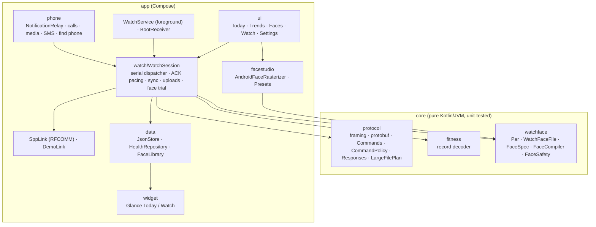

# Platform Map

SilentFit ships two native front ends over one protocol design:

* **Android** — Kotlin + Jetpack Compose in `Android/` (this is the primary app; the
  NF 2 is a Bluetooth Classic watch and Android is where it can be fully used).
* **Apple** (iOS, iPadOS, macOS) — SwiftUI in `Sources/` with the Swift package
  `SilentFitKit`. The Xcode project no longer drives an Android build
  (`SKIP_ACTION = none` in `Darwin/SilentFit.xcconfig`).

The Android app replaced the earlier Skip-transpiled build: Skip's Compose output could
not express the Nothing design system, Glance widgets or the face studio cleanly, and
debugging transpiled Kotlin around Bluetooth sockets was slow. The Swift code and its
docs remain for the Apple targets.

## 1. Android architecture

| Layer | Location | Notes |
|-------|----------|-------|
| Protocol & formats | `Android/core` | No Android dependencies; `gradle :core:test` runs the protocol, decoder, face codec and safety tests. |
| Session | `app/…/watch/WatchSession.kt` | All protocol state on one serial dispatcher; one command in flight until ACK (the firmware drops bursts). Every outgoing command passes `CommandPolicy`. |
| UI | `app/…/ui` | Compose, Nothing design language: Doto / Space Grotesk / Space Mono (OFL), monochrome palette with a single red accent, Lucide monoline icons (ISC) converted to vector drawables by `Tools/lucide-to-vector.py`. |
| Face studio | `app/…/facestudio`, `ui/faces` | Canvas rasterizer turns a `FaceSpec` into images; `core` compiles and validates the WF file. |
| Widgets | `app/…/widget` | Jetpack Glance. |

## 2. Capability matrix

| Capability | Android | macOS | iOS / iPadOS |
|-----------|:-------:|:-----:|:------------:|
| Connect to NF 2 (Classic SPP) | ✅ RFCOMM socket | ✅ IOBluetooth RFCOMM | ❌ iOS forbids SPP to non-MFi accessories |
| Connect to Berry BLE devices (0x6666) | ➖ | ➖ | ✅ CoreBluetooth (experimental) |
| Health sync, history, trends | ✅ | ✅ | ✅ with a BLE device / demo |
| Face studio & install | ✅ | ❌ | ❌ |
| Home-screen widgets | ✅ Glance | ❌ | ❌ |
| Forward app notifications | ✅ NotificationListenerService | ❌ no API | ❌ no API |
| Calls on the watch | ✅ HFP + TelecomManager | ➖ | ➖ |
| Music control from the watch | ✅ MediaSession | ❌ | ❌ |
| Find phone | ✅ ringtone + vibration | ✅ alert sound | ✅ alert sound |
| Quick-reply SMS | ✅ SmsManager | ❌ | ❌ |
| Background connection | ✅ foreground service | ✅ app open | ⚠️ `bluetooth-central` background mode |

### Why iOS can't reach the NF 2

The NF 2 speaks Berry only over **Bluetooth Classic SPP** and does not advertise over BLE.
iOS apps can only use Classic Bluetooth through the External Accessory framework, which
requires MFi certification. NoiseFit for iOS relies on newer devices that expose Berry
over BLE GATT (service `0x6666`), which the Swift `BleTransport` implements.

## 3. Battery strategy (Android)

Keeping a Classic link open costs little; waking the radio and CPU often costs a lot. So:

| Area | Behaviour |
|------|-----------|
| Link | One RFCOMM socket with a blocking reader thread — no polling. |
| Live data | The watch streams steps/heart rate only while the app UI is visible (`ProcessLifecycleOwner`); streaming stops when the app goes to the background. |
| Health sync | On the chosen interval (30 min / 1 h / 2 h / manual) and when the app opens after 15 min. Battery level is requested every 30 min. |
| Reconnect | Exponential backoff 5 s → 5 min; paused while Bluetooth is off. The system's ACL-connected and adapter broadcasts trigger an immediate reconnect instead of retry loops. |
| Service | Foreground service with a minimum-priority, silent notification (required for the socket to survive Doze). Restarted after boot and app updates. |
| Widgets | `updatePeriodMillis = 0`; widgets redraw only when their data changes (debounced 2 s). |
| Watch side | No periodic GETs besides battery; settings are read once per connection. |

## 4. Build & run

| Target | Command |
|--------|---------|
| Android tests + APK | `cd Android && gradle :core:test :app:assembleDebug` |
| Install | `adb install -r Android/app/build/outputs/apk/debug/app-debug.apk` |
| Official-face regression | `SILENTFIT_FACE_SAMPLE=/path/face.bin gradle :core:test` |
| Swift tests | `swift test` |
| Apple apps | Open `Project.xcworkspace`, scheme *SilentFit App*, choose an iPhone simulator or *My Mac* |

Toolchain used: Gradle 9, AGP 9.2, Kotlin 2.3, Compose BOM 2026.05, Glance 1.1, JDK 21
(targeting JVM 17), minSdk 29, targetSdk 36.
