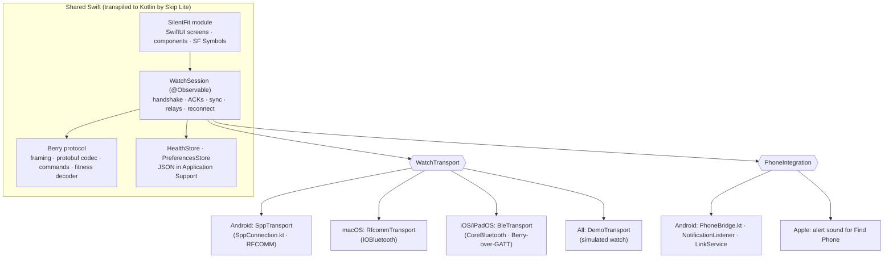

# Platform Map

How SilentFit uses **Skip** to ship one Swift/SwiftUI codebase on Android, iOS, iPadOS
and macOS, and what each platform can and cannot do with a Classic-Bluetooth watch.

## 1. Architecture

| Layer | Location | Notes |
|-------|----------|-------|
| UI | `Sources/SilentFit` | SwiftUI → Jetpack Compose via SkipUI. No Charts framework; charts are drawn with shapes so they render identically on both. |
| Session & model | `Sources/SilentFitKit/*.swift`, `Model/` | `@Observable` types drive SwiftUI and Compose alike. |
| Protocol | `Sources/SilentFitKit/Protocol` | Pure Swift, no dependencies, fully unit-tested. Written for Kotlin's 32-bit `Int` (Int64 for varints/timestamps) and explicit unsigned conversions. |
| Transports | `Sources/SilentFitKit/Transport` | One protocol, four implementations selected at compile time (`#if SKIP`, `os(macOS)`, `os(iOS)`). |
| Android services | `Sources/SilentFitKit/Skip/*.kt` | Hand-written Kotlin compiled into the Android build: SPP socket, notification listener, media sessions, call control, SMS, foreground service. |
| App shells | `Darwin/`, `Android/` | Entry points, Info.plist/entitlements, AndroidManifest permissions and services. |

### Icons

SF Symbols are used directly on Apple platforms. Their license does not allow shipping
them on Android, so every symbol name used in the UI has a same-named `.symbolset` in
`Sources/SilentFit/Resources/Module.xcassets` containing the equivalent **Material
Symbol** (Apache 2.0). On iOS/macOS `Image(systemName:)` always resolves to the real SF
Symbol; on Android SkipUI renders the bundled Material glyph. The mapping lives in
`Tools/symbols.txt`; regenerate with `Tools/fetch-symbols.sh`.

## 2. Capability matrix

| Capability | Android | macOS | iOS / iPadOS |
|-----------|:-------:|:-----:|:------------:|
| Connect to NF 2 (Classic SPP) | ✅ RFCOMM socket | ✅ IOBluetooth RFCOMM (watch paired to the Mac) | ❌ iOS forbids SPP to non-MFi accessories |
| Connect to Berry BLE devices (0x6666) | ➖ not needed | ➖ | ✅ CoreBluetooth (experimental) |
| Health sync, history, trends | ✅ | ✅ | ✅ with a BLE device / demo |
| Watch settings, alarms, faces, find watch | ✅ | ✅ | ✅ with a BLE device |
| Forward app notifications | ✅ NotificationListenerService | ❌ no API | ❌ no API (ANCS is system-provided, BLE only) |
| Calls on the watch (ring, answer, decline) | ✅ HFP + TelecomManager | ➖ | ➖ |
| Music control from the watch | ✅ MediaSession | ❌ | ❌ |
| Find phone | ✅ ringtone + vibration | ✅ alert sound | ✅ alert sound |
| Quick-reply SMS | ✅ SmsManager (permission) | ❌ | ❌ |
| Background connection | ✅ foreground service | ✅ app open | ⚠️ `bluetooth-central` background mode |

### Why iOS can't reach the NF 2

The NF 2 speaks Berry only over **Bluetooth Classic SPP** and does not advertise over BLE
(verified by scanning from this Mac with the phone's Bluetooth disabled). iOS apps can
only use Classic Bluetooth through the External Accessory framework, which requires the
accessory to be MFi-certified. NoiseFit for iOS therefore relies on newer Noise devices
that expose Berry over BLE GATT (service `0x6666`), which `BleTransport` implements.
The iOS/iPadOS build is fully functional with those devices and with the demo watch.

## 3. Build & run

| Target | Command |
|--------|---------|
| Protocol tests (macOS) | `swift test` |
| Real-capture regression | `SILENTFIT_CAPTURES=/path/captures.json swift test --filter CapturedSyncTests` |
| Android APK | `cd Android && gradle assembleDebug` → install with `adb install -r app/build/outputs/apk/debug/app-debug.apk` |
| iOS + Android together | Open `Project.xcworkspace`, select the *SilentFit App* scheme and an iPhone simulator; Skip builds and launches Android alongside |
| macOS | Same scheme, destination *My Mac* |
| Parity tests (Robolectric) | `skip test` |

## 4. Porting rules followed

* `Int` is 32-bit on Android: varints, timestamps and file lengths use `Int64`.
* Unsigned literals are always explicit (`ByteUtils.bytes([...])`, `UInt8(x)`).
* No GCD; concurrency uses `Task` and `@MainActor` hops from transport callbacks.
* No general key paths, no `ContentUnavailableView`, `accessibilityElement(children:)` or
  `monospacedDigit()` on Android — wrapped in platform-aware helpers (`EmptyStateView`,
  `accessibilityGroup()`, `digits()`).
* Kotlin-only APIs live in `#if SKIP` blocks or `.kt` files inside `Sources/<Module>/Skip`.
