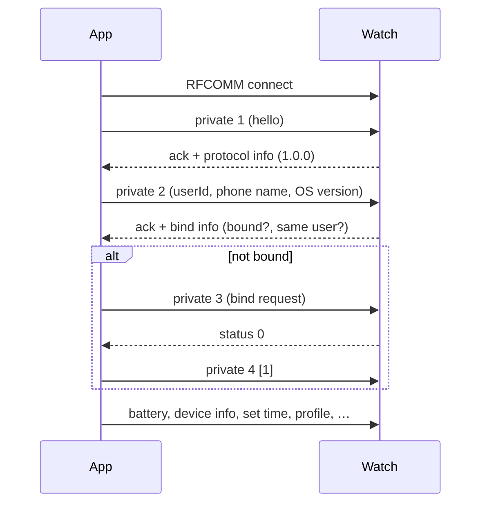
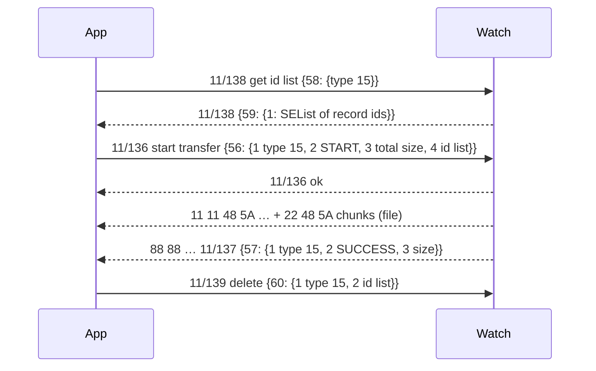

# Berry Protocol Reference (Noise "NF" watches)

This document describes the wire protocol SilentFit uses to talk to Noise watches that
run the ZH "Berry" firmware (for example the **NF 2**, model `59004`, firmware `1.0.39`).
It was reconstructed from:

- the NoiseFit Android app (v5.4.7, build 879) decompiled with jadx — specifically the
  vendored ZH SDK (`com.zhapp.ble.*`) and its generated protobuf classes (`com.zh.ble.*`),
- the app's own debug logs (`/sdcard/Android/data/com.noisefit/cache/logs`), which record
  every frame sent and received together with the SDK's decoded interpretation,
- live probing from macOS.

Every frame layout below is covered by a unit test in
[Tests/SilentFitKitTests](../Tests/SilentFitKitTests) that reproduces a captured frame
byte-for-byte.

---

## 1. Transport

| Item | Value |
|------|-------|
| Link | **Bluetooth Classic, SPP / RFCOMM** (UUID `00001101-0000-1000-8000-00805F9B34FB`) |
| Pairing | Standard Bluetooth bonding (the watch is also an HFP headset for calls) |
| BLE | NF 2 does **not** advertise over BLE. Newer Berry devices ("Berry-Ring") tunnel the same frames over GATT service `0x6666`: notify `0x005E`, write `0x005F`, MTU 517. |
| Byte order | Little-endian for all fixed-width integers |

Only one app can hold the RFCOMM channel. NoiseFit must be closed (force-stopped) before
SilentFit connects.

---

## 2. Framing

All frames start with a 4-byte head that ends in `48 5A` (`"HZ"`).

### 2.1 Command frames

```
offset  size  field
0       4     head      66 66 48 5A  app → watch request, or watch → app response
                         88 88 48 5A  watch → app request (watch-initiated)
4       1     serial    rolling 0–255, chosen by the sender
5       1     event     1 = protobuf, 2 = big data, 3 = private, 4 = log
6       1     type      3 for protobuf, 2 for private
7       2     length    payload length (u16 LE)
9       n     payload
```

### 2.2 Acknowledgement

```
99 99 48 5A | serial | error | 00 | 00        (8 bytes)
```

* The watch acknowledges every frame it receives.
* **The app must acknowledge every `66 66` and `88 88` frame it receives**, echoing the
  frame's serial with `error = 0`.

### 2.3 Large-file transfers (watch → app)

Fitness history, workouts and logs are streamed as a header frame followed by chunks:

```
11 11 48 5A | serial | event=4 | fileType | length (u16) | payload…
22 48 5A    | length (u16) | index | payload…     daily-data continuation
33 48 5A    | …                                   sport continuation
44 48 5A    | …                                   log continuation
```

`fileType` is 15 for daily fitness data and 7 for workouts. The concatenated payload
(header payload + all chunk payloads) is the **file**:

```
0   4   total length T (bytes after the 12-byte prefix)
4   8   reserved
12  T   records
```

No acknowledgements are sent for chunks. The transfer is complete when 12 + T bytes have
arrived; the watch then sends `DEVICE_CONTROL_LOG_FILE_SEND_STATUS` (§5).

---

## 3. Private commands (event 3)

Payload: `cmdId (u16) | length (u16) | data`.

| cmdId | Direction | Request data | Response data |
|------:|-----------|--------------|---------------|
| 1 | app → watch | — | Protocol info: `deviceType u16`, `version` bytes 2..4 (patch, minor, major), `albumVersion` @8, `platformType` @9, `albumRadius u16` @10, flags @12. Version must be `1.0.0`. Also used as a keep-alive. |
| 2 | app → watch | `len userId · 0xBB · len phoneName · len systemVersion` | Bind info: `deviceType u16`, firmware @2..4, MAC @5..10 (reversed), BT MAC @11..16, `snLen` @17, serial number, then a flag byte: bit 7 = *same user*, bit 6 = *bound*. |
| 3 | app → watch | — (request binding; the watch may ask the wearer to confirm) | `status u8`: 0 or 3 = accepted |
| 4 | app → watch | `u8` 1 = bind succeeded | `u8` status |

### Connection handshake



The **userId** is the account the watch is bound to. If the watch is bound to a
different id (e.g. the NoiseFit account), it reports *bound, not same user*. SilentFit
lets you enter the NoiseFit id so you can switch apps without resetting the watch.

---

## 4. Protobuf envelope (event 1)

Payload is a protobuf `SA.SEWear` message (proto2):

| Field | Name | Notes |
|------:|------|-------|
| 1 | `type` | category (below) |
| 2 | `id` | command within the category |
| 5 | `device` | `SEDevice` |
| 6 | `system_time` | `SESystemTime` |
| 7 | `user_settings` | `SEUserSettings` |
| 11 | `micro_function` | `SEMicroFunction` |
| 12 | `notification` | `SENotification` |
| 13 | `music` | `SEMusic` |
| 14 | `setting_menu` | `SESettingMenu` |
| 17 | `new_WatchFace` | `SAWatchFace` |
| 18 | `new_Weather` | `SAweather` |
| 100 | `error_code` | 0 OK, 1 not supported, 2 dependency not ready, 3 set failed, 4 param error, 255 unknown |

Responses echo `type`/`id`; acknowledgements of "set" commands carry only `error_code`.

### Categories (`type`)

| # | Name | # | Name |
|--:|------|--:|------|
| 1 | ACCOUNT | 10 | MUSIC |
| 2 | DEVICE | 11 | SETTING_MENU |
| 3 | SYSTEM_TIME | 12 | FACTORY |
| 4 | USER_SETTINGS | 13 | ALEXA |
| 5 | SPORTING | 14 | NEW_WATCH_FACE |
| 6 | FITNESS | 15 | NEW_WEATHER |
| 7 | GNSS | 16 | CHILDREN |
| 8 | MICRO_FUNCTION | 17 | AI_FUNCTION |
| 9 | NOTIFICATION | 18 | TV_REMOTE |

---

## 5. Commands used by SilentFit

Notation: `type/id → field{subfield…}`. Example frames are real captures.

### Device & time

| Command | Encoding |
|---------|----------|
| Get device info | `2/0` → response `device(5){device_info(1){1 fw, 2 model, 3 mac, 4 serial, 5 battery{1 level, 2 charge}}}` |
| Get battery | `2/1` — `66 66 48 5A 02 01 03 04 00 08 02 10 01` → `…2A 06 12 04 08 52 10 02` (82 %, not charging) |
| Set time | `3/0` → `system_time(6){time_set(1){1 unix seconds (UTC), 2 sint32 UTC offset in quarter-hours}}`; `66 66 48 5A 04 01 03 10 00 08 03 10 00 32 0A 0A 08 08 B0 CF F7 D6 06 10 2C` |
| Set profile | `4/4` → `user_settings(7){user_profile(5){1 height cm, 2 weight (float kg), 4 age, 5 sex, 7 calorie goal, 8 step goal, 9 distance goal m, 12 sleep goal h}}` |
| Set units | `4/2` → `user_settings(7){unit_type(3)}` 0 metric, 1 imperial |

### Micro functions

| Command | Encoding |
|---------|----------|
| Find watch | `8/1` (no payload) |
| Watch → find phone | `8/0` `micro_function(11){find_phone_mode(1)}` 0 start, 1 stop — e.g. `88 88 48 5A 03 01 03 08 00 08 08 10 00 5A 02 08 01` |
| Phone stopped ringing | `8/10` `micro_function(11){find_phone_mode(1)=1}` |
| Live data on/off | `8/4` `micro_function(11){basic_data_mode(3)}` 0 start, 1 stop → watch pushes `8/5` `basic_data(4){1 steps, 2 kcal, 3 distance, 4 HR, 5 SpO₂, 13 stress}` |

### Notifications & calls

| Command | Encoding |
|---------|----------|
| App notification | `9/3` `notification(12){app_notification(2){1 app name, 2 package, 3 title, 4 text, 5 ticker, 6 key}}` |
| Call / missed call / SMS | `9/2` `notification(12){system_notification(1){1 kind (0 call, 1 missed, 2 SMS), 2 number, 3 contact, 4 text, 5 app name, 6 package}}` |
| Call state | `9/4` `notification(12){call_state(4)}` 0 answer, 1 hang up, 2 mute. Sent by the app when a call ends (`08 09 10 04 62 02 20 01`), and by the watch when the wearer answers/declines. |
| Quick replies | get `9/5`; set `9/6` `notification(12){quick_reply_list(5){list(1){text(1)}…}}` |
| Quick reply sent | watch → `9/7` `notification(12){quick_reply_message(6){1 number, 2 text}}` |

### Music

| Command | Encoding |
|---------|----------|
| Now playing | `10/3` `music(13){player_info(1){1 state, 2 title, 3 player, 4 artist, 5 volume, 6 max volume, 7 duration s, 8 position s, 10 permission=1}}`. State: 2 playing, 3 paused, 4 stopped, 5 nothing playing. |
| Watch control | watch → `10/1` `music(13){player_control_command(2)}` 1 play, 2 pause, 3 previous, 4 next, 5 vol+, 6 vol− |
| Watch asks for state | watch → `10/0` |

### Settings menu (`type 11`, payload in `setting_menu(14)`)

| Setting | Get / Set id | Field | Message |
|---------|-------------|------:|---------|
| Raise to wake | 0 / 1 | 1 | `{1 mode (0 all-day, 1 timed, 2 off, 3 smart), 2 start, 3 end, 4 sensitivity}` |
| Heart-rate monitor | 6 / 7 | 3 | `{1 mode (0 auto, 1 off), 2 interval min, 3 alert on, 4 alert bpm, …}` |
| Sedentary reminder | 9 / 10 | 4 | `{1 on, 2 start, 3 end, 4 interval min, 5 lunch break}` |
| Alarms | 12 / 13 | 5 | `list(1){1 id, 2 data{1 time, 2 weekday mask, 3 enabled, 4 name, 5 label}}` |
| Drink-water reminder | 18 / 19 | 7 | same as sedentary |
| Do not disturb | 21 / 22 | 8 | `{1 on, 2 start, 3 end}` |
| Stress | 76 / 77 | 28 | `{1 on, 2 relax reminder}` |
| SpO₂ | 82 / 83 | 30 | `{1 mode (0 auto, 1 off), 2 interval min}` |

Times are `SESettingTime{1 hour, 2 minute}`.

### Watch faces (`type 14`, payload `new_WatchFace(17)`)

| Command | Encoding |
|---------|----------|
| List | `14/0` → `watch_face_list(1){list(1){1 id, 2 name, 3 is current, 4 can remove, …}}` |
| Select | `14/1` `{id(2)}` |
| Remove | `14/2` `{id(2)}` |
| Prepare install | `14/4` `{prepare_info(6){1 id, 2 size, 3 background size, 7 style}}` → watch `14/4` `{prepare_reply(9){1 id, 2 status, 3 compress, 4 expected slice, 6 corner radius}}` |
| Install result | watch → `14/5` `{install_result(7){1 id, 2 code}}` — code 2 = success |
| Watch changed face | watch → `14/13` |

Prepare status: 0 ready, 1 busy, 2 already installed, 3 low storage, 4 low battery,
5 newer version present, 6 low storage (ask the user to delete). The NF 2 keeps **one**
downloadable face; status 3 means the old one must be removed first.

After a ready reply the face file is sent as a large-file upload (frame type 5): a
12-byte prefix `u32 length, u32 type, u32 0` followed by the file. The first slice
travels in an event-2 `66 66` frame; later slices are raw. Slices are the smallest
multiple of 990 bytes at or above the watch's expected slice length, and the watch ACKs
about every 4096 bytes. The file format is in [WATCHFACE_FORMAT.md](WATCHFACE_FORMAT.md).

### 5.1 Command safety policy

The NF 2 firmware trusts what it receives. An unverified watch-face record put it into a
boot loop (`00005212`), and a later session with unverified fields ended in a crash
(`00001002`) that needed a factory reset. SilentFit therefore classifies every command
(`CommandPolicy` in `core/…/protocol/Commands.kt`):

| Tier | Commands | Sent |
|------|----------|------|
| **Proven** | hello, user id, bind; device info `2/0`, battery `2/1`; time `3/0`; find watch `8/1`; live data `8/4`; notifications `9/2`, `9/3`, call state `9/4`, quick-reply list `9/5`; now playing `10/3`; fitness sync `11/136`, `11/138`, `11/139`; settings **GETs**; face list/select/remove/prepare `14/0,1,2,4` | Always |
| **Experimental** | every settings SET, profile/units/temperature/language `4/x`, launcher `8/6–12`, find-phone stop `8/10`, quick-reply SET `9/6`, face support data `14/10`, face edit `14/11` | Only after the user enables *Experimental watch controls* |

"Proven" means the frame was captured from NoiseFit talking to this watch on firmware
1.0.39, including a fresh pairing after a factory reset, or it is a read-only request
that earlier SilentFit builds sent many times without issue. Unit tests check the proven
commands byte for byte against the NoiseFit captures (`SafetyTest`).

---

## 6. Health data sync



A record id (`SEBigFile_Fitness_TypeId`) is `{1 time{1 year,2 month,3 day,4 h,5 m,6 s}, 2 function type, 3 record length (incl. header), 4 struct version, 5 crc}`.

### Record layout

Each record = 9-byte header + payload, in id-list order:

```
0  2  year      2  1 month   3  1 day   4..6  h/m/s
7  1  function type          8  1  struct version
```

Layouts below were derived by known-plaintext comparison against the vendor's native
parser (`libberryParsing.so`) output recorded in its logs, and validated on 13 real syncs.

| Type | Name | Payload |
|-----:|------|---------|
| 0 | Daily activity (275 B) | `u32 steps`, `u32 distance m`, `u32 kcal`, `u16[24] hourly steps` @12, `u16[24] hourly distance` @60, `u16[24] hourly kcal` @108, 3 × `u8 frequency` @156 |
| 1 | Sleep | `u32 start`, `u32 end` (Unix s), `u16 total min` @8, `u8 score` @10, `u16 awake` @11, `u8 awake %` @13, `u16 light` @14, `u8 %` @16, `u16 deep` @18, `u8 %` @20, `u16 REM` @22, `u8 %` @24, `u8 n` @26, then `n × {u32 start, u16 minutes, u8 stage}` (0 awake, 1 light, 2 deep, 3 REM) |
| 2 | Continuous heart rate | `u8[288]` (5-min slots), `u8 max`, `u8 min`, `u8 interval`, hourly max/min |
| 4 | Continuous SpO₂ | `u8[144]` (10-min slots), min/max, hourly min/max, `u8 interval` @194 |
| 6 | Continuous stress | `u8[144]` (10-min slots), `u8 max`, `u8 min`, `u8 interval` @146 |
| 11 | Effective standing | `u8[24]` flags, `u8 interval` |
| 12 | Activity duration | `u8[24]` minutes per hour, `u8 interval`, per-category totals |

Other function types (offline HR/SpO₂/temperature, ECG, GoMore algorithms, water) exist in
the schema but were not observed on the NF 2.

---

## 7. Schemas

The complete proto2 schemas (`sa_*.proto`, 19 files, ~300 messages) were recovered from
the descriptors embedded in the generated Java classes. They are not committed because
they are vendor material; regenerate them locally with the tooling described in
[REVERSE_ENGINEERING.md](REVERSE_ENGINEERING.md).
