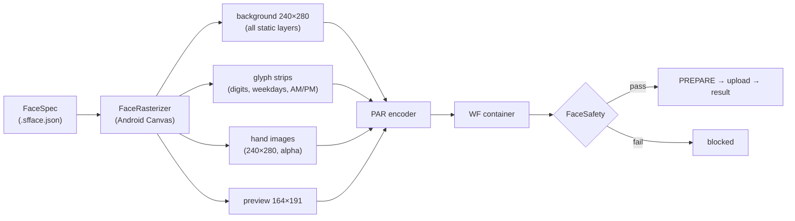

# Watch-Face Format (Noise NF 2 / Bluetrum)

How a downloadable face for the NF 2 is built, byte by byte. The encoder in
`Android/core/src/main/kotlin/fit/silent/core/watchface/` reproduces an official face
**byte for byte** (`WatchFaceTest.vendorSampleReencodesIdentically`).

> **Safety first.** The watch does not validate faces. A file with an unknown record id
> put a test watch into a boot loop (error `00005212`) that only a factory reset cleared.
> SilentFit only sends files that pass `FaceSafety` (§6), and every new face runs as a
> trial (§7). Do not hand-craft files outside these rules.

Device facts: Bluetrum chip, platform type 7, device type 59004, firmware 1.0.39,
screen **240 × 280**, rounded corners (radius 28 reported by the watch).

## 1. Overview



Static layers (text, shapes, images) are flattened into one background image. Only live
values become records: the watch draws them by picking a frame from a vertical strip.

## 2. WF container

All integers are little-endian.

| Offset | Size | Value |
|-------:|-----:|-------|
| 0x00 | 2 | `'W' 'F'` |
| 0x02 | 2 | version `0x0414` |
| 0x04 | 4 | 0 |
| 0x08 | 2 | 1 or 0 (official faces use both 1/1 and 0/0) |
| 0x0A | 2 | 1 or 0 |
| 0x0C | 30 | zeros |
| 0x2A | 2 | screen width (240) |
| 0x2C | 2 | screen height (280) |
| 0x2E | 2 | record count |
| 0x30 | 4 | total file size |
| 0x34 | … | record table, then image data |

Each table entry is `u32 imageOffset` followed by a record body. Images are stored once
in order of first use; several records may point at the same image (e.g. month and day
share one digit strip).

### Record body

Common 8 bytes: `u8 type, u8 dataId, u16 frames, s16 x, s16 y`, then 8 type-specific
bytes:

| Type | Meaning | Extra 8 bytes |
|-----:|---------|---------------|
| 1 | rotating hand | `u16 pivotX, u16 pivotY, u32 angle×10` (900 = image drawn pointing at 3 o'clock) |
| 2 | image / image sprite | zeros |
| 4 | number / indexed sprite | `u8 1`, then a 7-byte ASCII name (zero padded) when `dataId = 0xFF` |

**Compact** records (16-byte body) are the background, the preview and hands. All
others are **long** records (39 bytes) with 23 more bytes. A parser tells them apart
by the `extern` tag (the header words at 0x08/0x0A are not reliable):

```
"extern!I" (left-aligned) | "externci" (right-aligned)
00 00 09 00 00 00 01 00 00 00 01 00 00 00      fixed
u8 anchor                                       1 left, 3 right
```

For right-aligned values `x` is negative and measured from the right edge
(`x = -(240 - rightEdge)`), so numbers grow leftwards.

### Record order

1. background — type 2, id `0x10`, 1 frame, at (120, 140) = screen centre
2. preview — type 2, id `0x11`, 1 frame, 164 × 191, at (0, 0) or (120, 140)
3. long records (live values, optional static images)
4. hands, hour (`0x05`) before minute (`0x06`), always last

## 3. PAR image codec

```
0   'P' 'A'  u8 0  u8 alpha  u16 width  u16 height  u8 tile  u8 tableWidth  u16 average  u32 0
16  offset table — (rows or tiles) + 1 entries, each a signed tableWidth-byte delta;
    offset[i] = delta[i] + average × i
…   pixel stream
```

* `tile = 0`: one stream per row. `tile = 30`: 31 × 31 tiles stepping 30 px (used for
  the full-screen hand images).
* `tableWidth` is the smallest of 1–4 bytes that fits all deltas.
* Pixels are RGB565. Opcodes:

| Opcode | Meaning |
|--------|---------|
| `0x00–0x7F` | diff: `r5 += ((op>>5)&3)−2`, `g6 += ((op>>2)&7)−4`, `b5 += (op&3)−2` |
| `0x80 \| n` | run of `n` pixels: `[alpha u8 if the image has alpha]` `u16 rgb565` |
| `0xC0 \| n` | literal: `n × u16 rgb565` (alpha unchanged) |

* Opaque images premultiply each channel by alpha the way the vendor tool does:
  `c × a × 0x8081 >> 23`.
* The encoder mirrors the vendor's opcode choices exactly (`Par.encode`).

## 4. Data ids

Only these ids appear in official faces for this watch (an analogue face and two digital
store faces), and they are the **only** ids SilentFit will send.

| Binding | Type | Id | Name | Frames | Notes |
|---------|-----:|---:|------|-------:|-------|
| Background | 2 | `0x10` | | 1 | also used for small static images |
| Preview | 2 | `0x11` | | 1 | 164 × 191, shown in the watch's face picker |
| Month | 4 | `0x02` | | 10 | digit strip 0–9 |
| Day | 4 | `0x03` | | 10 | |
| Hour, first digit | 4 | `0x08` | | 10 | one digit per record |
| Hour, second digit | 4 | `0x09` | | 10 | |
| Minute, first digit | 4 | `0x0A` | | 10 | |
| Minute, second digit | 4 | `0x0B` | | 10 | |
| Hour (two digits) | 4 | `0x05` | | 10 | whole value in one record; as type 1 the same id is the hour hand |
| Minute (two digits) | 4 | `0x06` | | 10 | as type 1: minute hand |
| AM / PM | 2 | `0x1F` | | 2 | |
| Calories | 4 | `0x40` | | 10 | |
| Steps | 4 | `0x41` | | 10 | |
| Weekday | 4 | `0xFF` | `PICBOX1` | 7 | frame order as `GlyphSet.WEEKDAYS` |
| Heart rate | 4 | `0xFF` | `NUMBER4` | 10 | must follow `N_DATA4` |
| Heart rate (no reading) | 4 | `0xFF` | `N_DATA4` | 1 | placeholder, same position |
| Battery | 4 | `0xFF` | `NUMBER2` | 10 | |
| Hour hand | 1 | `0x05` | | 1 | |
| Minute hand | 1 | `0x06` | | 1 | |

Digital time is drawn digit by digit: the studio's *Hour* and *Minute* elements compile
to two records each (`0x08`+`0x09`, `0x0A`+`0x0B`), exactly like the first store face;
the four digits can also be placed individually.

Frames are plain pictures: the watch copies frame *n* to the record's position and
nothing else. Official faces use this for rotated weekday text, so glyph styles (LED
dots, 7-segment), rotation and a background patch behind each glyph change only pixels,
never the record structure. SilentFit gives every single-glyph record (weekday, AM/PM,
time digits) the exact piece of background behind it, so glyphs sit seamlessly on
patterns and photos.

**Not supported:** seconds, second hand, year, distance, SpO₂, off-centre hands and
any other id. A probe face using ids `0x00–0x0E` boot-looped the watch; `0x08–0x0B`
are now proven by an official face, so the culprit is among the others. `Binding.verified
= false` marks these; the compiler refuses them and the studio hides them.

## 5. Installing

See [PROTOCOL.md §5 Watch faces](PROTOCOL.md#watch-faces-type-14-payload-new_watchface17):
`14/4` PREPARE → wait for a ready reply → large-file upload (type 5) → `14/5` result
(code 2 = success). SilentFit then optionally selects the face (`14/1`).

Face ids SilentFit generates are `9` + six random digits. Built-in faces cannot be
removed. Removing the current face is refused by the app.

## 6. Safety check (`FaceSafety`)

Every file — compiled, imported `.sfface`, or a raw WF file — is checked before upload
and raw files are checked again at import. A file passes only if:

* header: magic, version `0x0414`, zero flags, counts 1/1 or 0/0, zero
  padding, 240 × 280, size field equals file size, 2–64 records
* record 1 is the background (opaque 240 × 280, centred); record 2 the preview
  (opaque 164 × 191 at 0, 0 or 120, 140); compact/long form matches the record kind
* every long record matches a row of the table in §4 by type, id, frame count and name
  exactly; each live binding appears at most once; `N_DATA4` is immediately followed by
  `NUMBER4`
* long-record extra bytes and the 23-byte tail match the official bytes; alignment tag
  and anchor agree
* live images are opaque, untiled, split evenly into their frames, at most 120 px wide
  and 870 px tall per strip (the largest official strip), and lie on screen
* hands are ids `0x05`/`0x06` in order, last, full-screen transparent images tiled at
  30, centred, pivot exactly (120, 140), angle 900
* every image offset and every row/tile offset stays inside the file

The rules are tested against both official faces (pass, and re-encode byte for byte)
and a set of mutations (all rejected) in `SafetyTest`.

## 7. Face trial (watchdog)

When a downloaded face is selected, SilentFit records a *trial* (face id + a built-in
fallback) in its settings. If the link stays up for 3 minutes, or the user taps
*It works — keep it*, the trial ends. If the watch disconnects first (a crash reboots
it), the next connection immediately selects the built-in fallback and removes the new
face, and the app explains what happened.
